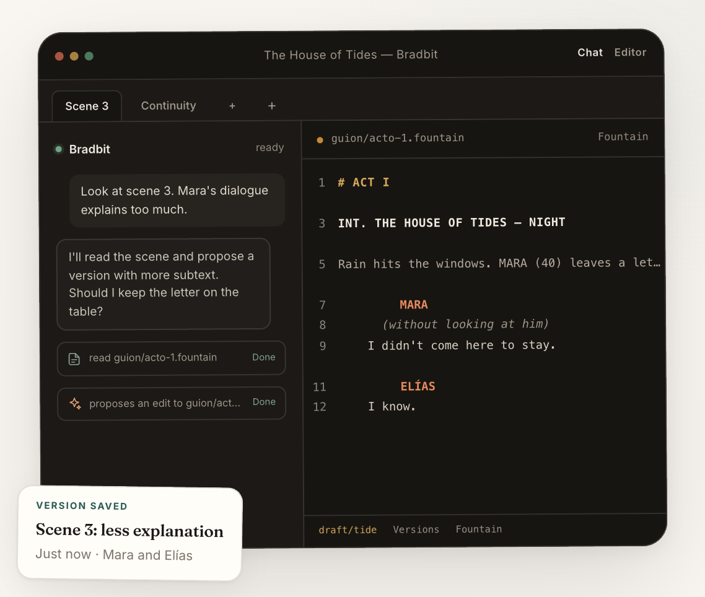

<p align="center">
  
</p>

<h1 align="center">Bradbit Editor</h1>

<p align="center">
  A desktop writing room for screenwriters and authors.
</p>

<p align="center">
  <a href="https://github.com/akolormedia/bradbit-editor/releases/latest"></a>
  
  
  <a href="LICENSE"></a>
  <a href="https://github.com/akolormedia/bradbit-editor/actions/workflows/ci.yml"></a>
</p>



<p align="center"><em>Illustrative preview of the writing workspace. The real app uses your project, theme and fonts.</em></p>

Bradbit Editor is a macOS app for writing **Markdown**, **MDX**, **Fountain** and **plain text**. It keeps your folder as the source of truth, saves versions without Git, and puts an optional AI writing room beside the page.

> **Alpha `0.1.0-alpha.5`** · macOS 13+ · Apple Silicon and Intel · ad-hoc signed, not notarized. See the [installation guide](docs/INSTALL.md) and [`CHANGELOG.md`](CHANGELOG.md).

## Why Bradbit

- **Your folder is the project.** No import, no proprietary project file, no database. Open any folder and keep writing.
- **Versions without the vocabulary.** Save a version, read changes in plain language, restore one file or open a parallel draft. Git works underneath with libgit2; you never have to see it.
- **An assistant with the manuscript open.** Chat beside the page. The agent reads the files you point to, proposes edits and asks before running tools. Every change can be reviewed in the diff.
- **Built for scripts.** Fountain highlighting, scene outline, paginated preview and screenplay-formatted PDF export.
- **Local-first and BYOK.** No account. AI keys live in the macOS Keychain. Writing works offline and never waits for a model.

## Download and install

**Requirements:** macOS 13 Ventura or later, Apple Silicon or Intel, about 1 GB free.

1. Download the latest `Bradbit Editor_<version>_universal.dmg` from the [releases page](https://github.com/akolormedia/bradbit-editor/releases/latest).
2. Drag **Bradbit Editor** into **Applications**.
3. On first launch, macOS blocks the app because it is ad-hoc signed but not notarized. Open **System Settings → Privacy & Security**, scroll down and click **Open Anyway**.

No Git, Node, Rust, Xcode, Command Line Tools or OpenCode installation is required. History, versions and GitHub sync use the bundled libgit2 engine; the agent runtime is bundled as a sidecar.

Full instructions, troubleshooting and uninstall: **[English](docs/INSTALL.md)** · **[Español](docs/INSTALL.es.md)**.

## Quick start

1. Open Bradbit and choose **Open folder**, or create a project from a writing kit.
2. Write in the editor. Use the **Explorer**, **Outline** and **Versions** sections on the left.
3. Optional: open **Connect model** and follow the guided setup. Keys are stored in the macOS **Keychain**, never in the project.
4. Save a version from the **Versions** panel when you reach a point worth keeping. No terminal required.

## Writing kits

Three kits ship with the app. Each one is a plain folder with agents, commands, skills and examples; you can edit it or create your own.

| Kit | What it is for | Spanish command examples |
|---|---|---|
| **Screenwriting** (`guionista-kit`) | Film, series and microdrama; story bible, structure, scenes, research and Fountain scripts. | `/escena`, `/revisar`, `/voz` |
| **Novel** (`libro-kit`) | Novels and long-form books; chapters, characters, continuity, revision and pitch. | `/capitulo`, `/personaje`, `/sinopsis` |
| **Advertising campaigns** (`campaign-kit`) | Client workspaces, briefs, strategy, concepts, copy, deliverables and approvals. | `/cliente`, `/brief`, `/concepto` |

Kit instructions are in English; the agent replies and writes in the language configured in the app. See the [feature guide](docs/FEATURES.md) for the full feature inventory.

## Import and export

- **Import a Word manuscript:** with a folder open, choose **File → Import → DOCX…**. It creates a single `manuscript/imported.md` (or `imported-2.md` if needed) and shows what will be kept and what will be lost before writing. Headings, paragraphs, bold and italic are preserved; images, tables, comments, tracked changes and advanced Word styles are not.
- **Import a Final Draft screenplay:** choose **File → Import → Final Draft (.fdx)…**. It converts the FDX to Fountain in `script/imported.fountain` and previews the result before writing.
- **Export a Markdown manuscript to DOCX:** choose **File → Export DOCX…**. It uses the standard manuscript preset: A4, 2.5 cm margins, Times New Roman 12 pt, double spacing, title page and page numbers.
- **Export a screenplay:** Fountain files have **Export PDF** (`⌘E`) with deterministic screenplay formatting.
- **Export any folder to PDF:** right-click a folder under **Files** and choose **Export folder to PDF…**. A Markdown folder becomes one A4 book PDF (`exports/<folder>/<folder>.pdf`) with a title page, chapter breaks and page numbers. A Fountain folder produces one screenplay PDF per script under `exports/`. If a folder mixes both formats, Bradbit asks you to choose a single-format folder instead of guessing.

## Documentation

- [Installation guide (English)](docs/INSTALL.md) · [Español](docs/INSTALL.es.md)
- [Feature guide](docs/FEATURES.md)
- [Changelog](CHANGELOG.md)
- [Issues](https://github.com/akolormedia/bradbit-editor/issues)
- Public site and docs: **`bradbit.io/docs`** (coming with the beta; the URL will be the canonical documentation home).

## Architecture

- **Tauri v2 + Rust** for the native macOS shell, menus, file system, Keychain, PDF export and process management.
- **CodeMirror 6** for the editor, Markdown/MDX and Fountain syntax, search and the writing workspace.
- **libgit2** for local versions, diffs, branches and GitHub sync. No system Git or Command Line Tools.
- **`bradbit` sidecar** for the agent runtime, built from [`bradbit-cli`](https://github.com/akolormedia/bradbit-cli), a fork of OpenCode.
- **Project kits** in `.bradbit/` for agents, commands and skills. `.opencode/` remains legacy-compatible.

The editor is intentionally agnostic: scene, character and outline behavior belongs to the kit, not to the editor engine.

## Development

```bash
npm install
npm run fetch:bradbit      # download the sidecar for the current architecture
npm run tauri dev          # native app with hot reload
```

The packaged WebView has developer tools disabled (`app.windows[0].devtools` in
`src-tauri/tauri.conf.json`) so the writer-facing app never exposes *Inspect
Element*. For UI inspection, run the Vite frontend in a browser with
`npm run dev`; use the Rust tests for native behavior.

Useful checks:

```bash
npm run typecheck
npm test
npm run build
cargo test --manifest-path src-tauri/Cargo.toml
cargo clippy --manifest-path src-tauri/Cargo.toml --all-targets -- -D warnings
```

Build the universal installer:

```bash
npm run sidecar:universal
npm run tauri build -- --target universal-apple-darwin --config src-tauri/tauri.sidecar.conf.json
# DMG: src-tauri/target/universal-apple-darwin/release/bundle/dmg/
```

The sidecar version and asset names are pinned in [`bradbit-cli.json`](bradbit-cli.json). Downloaded binaries live in `src-tauri/binaries/` and are not committed.

## Contributing

Issues and pull requests are welcome. Keep changes consistent with the editor's agnostic design: writing-specific behavior belongs in a kit or a template, not in the editor engine. For anything user-facing, include tests and update the docs in the same change.

## License

Bradbit Editor is **MIT licensed**. See [`LICENSE`](LICENSE).

The app bundles third-party components under their own licenses, including:

- **libgit2** — GPLv2 with linking exception (statically linked).
- **Tauri CSS stack and DOMPurify** — MPL-2.0 (DOMPurify is distributed under its Apache-2.0 option).
- **`bradbit` sidecar** — MIT, with OpenTUI/FFmpeg under LGPL-2.1-or-later.

The complete notices, source links and full license texts are in [`THIRD_PARTY_NOTICES.md`](THIRD_PARTY_NOTICES.md) and [`licenses/`](licenses/), and are bundled inside the app. Bradbit and the Bradbit mark are trademarks of Akolormedia.
